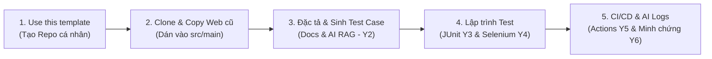

# SOF309: KIỂM THỬ NÂNG CAO CÙNG AI
> **Master Template Assignment dành cho Sinh viên FPT Polytechnic**  
> Giảng viên hướng dẫn: **ThS. Trần Quang Bình (binhtq7 - Thầy Mười Giáo)**

---

## 📌 PHẦN I. SƠ ĐỒ LUỒNG THỰC HIỆN (TIMELINE FLOW)



---

## 🚀 PHẦN II. HƯỚNG DẪN 5 BƯỚC TÍCH HỢP WEB CÓ SẴN VÀO REPO

### 🔹 Bước 1: Khởi tạo Repo cá nhân từ Template
1. Tại **góc trên bên phải màn hình** trang này, nhấn nút xanh **Use this template** $\rightarrow$ chọn **Create a new repository**.
2. Điền thông tin biểu mẫu theo quy chuẩn:
   * **Repository name:** `SOF309_<MÃ_LỚP>_<MSSV>_<HọVàTên>` *(Ví dụ: `SOF309_SD21307_PD12345_NguyenVanA`)*
   * **Visibility:** Chọn **Public** (Bắt buộc để Giảng viên truy cập chấm bài).
3. Nhấn nút xanh **Create repository** ở đáy biểu mẫu.

### 🔹 Bước 2: Clone về máy tính & Chạy thử
Mở Terminal / Git Bash trên máy tính và gõ:
```bash
git clone https://github.com/<tai-khoan-cua-ban>/SOF309_<MÃ_LỚP>_<MSSV>_<HoTen>.git
```

### 🔹 Bước 3: Đưa Source Web cũ vào dự án
1. Mở thư mục dự án vừa clone bằng IntelliJ IDEA hoặc VS Code.
2. **Copy toàn bộ mã nguồn Web cũ** của bạn (các package Controllers, Services, Models, HTML/JSP...) dán vào thư mục `src/main/java/` và `src/main/resources/`.
3. Mở file `pom.xml`, dán thêm các thư viện cần thiết của web cũ (Spring Boot, MySQL, Thymeleaf...) vào mục `<dependencies>`. File `pom.xml` của Thầy đã cấu hình sẵn **JUnit 5** và **Selenium WebDriver 4**.
4. Khởi động Web và kiểm tra tại `http://localhost:8080` để đảm bảo hệ thống chạy tốt (**Xong Y1**).

### 🔹 Bước 4: Viết Test Script & Tài liệu
1. **[Y2] Kế hoạch & Kịch bản Test:** Mở thư mục `docs/` để điền đặc tả `SPECIFICATIONS.md`, kế hoạch `TEST_PLAN.md` và bảng `TEST_CASES.md`.
2. **[Y3] Viết JUnit Test:** Viết các class test cho Controller trong `src/test/java/.../controllers/` (xem file mẫu `SampleControllerTest.java`).
3. **[Y4] Viết Selenium UI Test:** Viết các class Page Object trong `src/test/java/.../ui/pages/` và kịch bản test trong `src/test/java/.../ui/tests/` (xem file mẫu `LoginPage.java` và `LoginTest.java`).
4. **[Y6] Lưu minh chứng AI (Điểm A):** Ghi chép câu lệnh (prompt), code AI sinh và code bạn tự sửa vào các file trong thư mục `docs/ai-logs/`.

### 🔹 Bước 5: Đẩy bài lên GitHub & Nộp link
```bash
git add .
git commit -m "feat: complete assignment automation tests"
git push origin main
```
* **Kiểm tra kết quả:** Truy cập tab **Actions** trên GitHub. Workflow tự động chạy và hiển thị dấu tích **Xanh lá cây (Pass)** (**Xong Y5**).
* **Nộp bài:** Sao chép đường link GitHub Repo của bạn nộp vào **Google Classroom** của lớp.

---

## 📁 PHẦN III. CẤU TRÚC THƯ MỤC QUY CHUẨN

```text
SOF309_<MÃ_LỚP>_<MSSV>_<HoTen>/
├── pom.xml                               # Đã tích hợp sẵn JUnit 5 & Selenium 4
├── .github/
│   └── workflows/
│       └── test.yml                     # [Y5] Tự động chạy test khi push code
├── docs/                                # [Y2 & Y6] Tài liệu & Minh chứng AI
│   ├── SPECIFICATIONS.md                # [Y1] Đặc tả nghiệp vụ Web cá nhân
│   ├── TEST_PLAN.md                     # [Y2] Kế hoạch kiểm thử
│   ├── TEST_CASES.md                    # [Y2] Bộ kịch bản Test Case chi tiết
│   └── ai-logs/                         # [Y6] Minh chứng tương tác AI (Điểm A)
│       └── README.md
├── src/
│   ├── main/                            # [Y1] Mã nguồn Web cá nhân của sinh viên
│   │   ├── java/
│   │   └── resources/
│   └── test/java/com/poly/sof309/
│       ├── controllers/                 # [Y3] Viết JUnit Test Script cho Controller
│       │   └── SampleControllerTest.java
│       └── ui/                          # [Y4] Viết Selenium Test (Page Object Model)
│           ├── pages/                   # Các class Page Object (LoginPage.java...)
│           │   └── LoginPage.java
│           └── tests/                   # Kịch bản test chạy trên trình duyệt
│               └── LoginTest.java
├── .gitignore
└── README.md
```

---

## 🎯 PHẦN IV. BẢNG TIÊU CHÍ ĐÁNH GIÁ (RUBRIC Y1 - Y6)

| Hạng điểm | Yêu cầu hoàn thành | Chi tiết nghiệm thu |
| :---: | :--- | :--- |
| **A (8.0 - 10.0)** | **Y1 đến Y6** | • Hoàn thành toàn bộ test JUnit và Selenium.<br>• Pipeline GitHub Actions báo xanh.<br>• **Bắt buộc:** Đầy đủ các file minh chứng trong `docs/ai-logs/` và vấn đáp bảo vệ tốt. |
| **B (7.0 - 7.9)** | **Y1 đến Y5** | • Web chạy tốt, có kịch bản test, JUnit, Selenium và CI/CD Actions chạy pass (thiếu hoặc chưa hoàn chỉnh minh chứng AI Y6). |
| **C (5.0 - 6.9)** | **Y1 đến Y3** | • Web chạy được, có Test Plan/Test Case và chạy được Unit test JUnit (chưa làm Selenium UI và CI/CD). |
| **D (< 5.0)** | **Dưới 3 yêu cầu** | • Không hoàn thành đủ các yêu cầu cơ bản $\rightarrow$ **Học lại**. |
